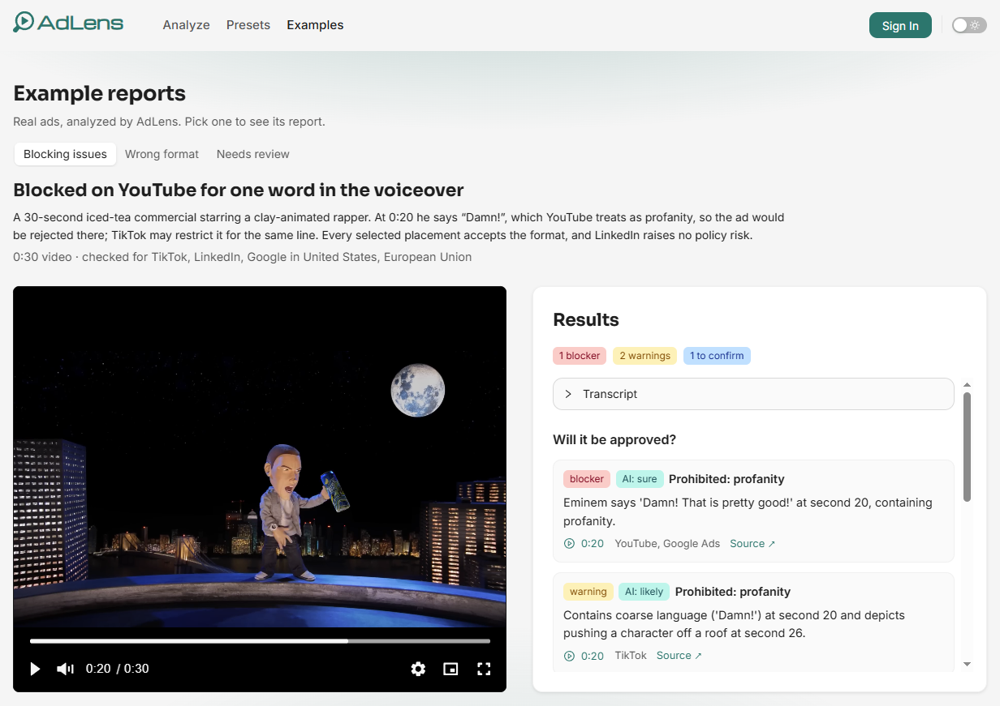

# AdLens

AI policy checks for video ads. Upload an ad of up to 3 minutes, say where it will run (platforms, placements,
markets), and AdLens checks it against the platforms' ad policies and creative best practices. Every finding is
timestamped, cites the policy or guide it comes from, and seeks the replayed video when clicked.

**[Try it live](https://www.useadlens.com)** · **[Example reports](https://www.useadlens.com/demo)** (no sign-up)

[](https://github.com/haggifer/adlens/actions/workflows/ci.yml)
[](LICENSE.md)



AdLens is three repositories. This one is the web app; start here.

| Repo                                                       | What it is                                                                                                |
| ---------------------------------------------------------- | --------------------------------------------------------------------------------------------------------- |
| **adlens** (this repo)                                     | Next.js web app on Vercel                                                                                 |
| [adlens-api](https://github.com/haggifer/adlens-api)       | NestJS API, the Gemini analysis worker and the daily cleanup on Cloud Run (with the architecture diagram) |
| [adlens-shared](https://github.com/haggifer/adlens-shared) | The API contract: Zod schemas and inferred types, published to npm                                        |

## Getting started

```bash
npm install
cp .env.example .env.local
npm run dev
```

Open [http://localhost:3000](http://localhost:3000). It expects the API at `NEXT_PUBLIC_API_BASE_URL` (default
`http://localhost:8080`). Locally, cookies work because `localhost:3000` and `localhost:8080` are the same site.

- `npm run dev` — dev server (Turbopack)
- `npm run build` / `npm run start` — production build and server
- `npm test` — Jest and React Testing Library; tests sit next to their modules, shared helpers (render with
  providers, auth states, fixtures) in `src/test/`
- `npm run lint` — ESLint
- `npm run knip` — unused files, exports and dependencies, which ESLint can't see across files (`knip.json`; CI runs it)
- `npm run format` — Prettier

## Highlights

- **Race-safe job lifecycle.** Every status change is one conditional update on the expected status, so a double
  click or a retried request can't verify, charge or start an analysis twice, and a failed run is always refunded
  ([API: Job lifecycle](https://github.com/haggifer/adlens-api#job-lifecycle)).
- **Uploads go straight to Cloud Storage** through V4 signed URLs that bind the exact type and size and can only
  create, so the API never carries the video and a verified upload can't be replaced.
- **One Cloud Run image, four entry points:** the API, an on-demand analysis job (one execution per analysis,
  nothing running between them), a scheduled daily cleanup and a database job run after each deploy
  ([API: Design decisions](https://github.com/haggifer/adlens-api#design-decisions)).
- **Live updates are signals, not data.** The API announces a change over Ably and the tab reads it again through
  the API, which stays the one place that decides what a user may see.
- **A shared Zod contract on npm with exact pins**, rather than a monorepo: the web app and the API deploy
  independently, and every contract change is an explicit version bump
  ([adlens-shared](https://github.com/haggifer/adlens-shared#design-decisions)).
- **The first analysis needs no account:** an anonymous session starts with the first run, Turnstile only interrupts
  when Cloudflare asks for a click, and the quota is a rolling 7-day window that refunds failed runs.

## Stack

- **Next.js 16** (App Router), **React 19**, **TypeScript**
- **Ant Design 6** with `antd-style`, server-rendered through `@ant-design/nextjs-registry`; Bootstrap 5 utility
  classes for layout
- **Better Auth**: email and password, Google and GitHub sign-in, anonymous sessions
- **Cloudflare Turnstile** for the human check
- **TanStack Query** for server state, kept current by **Ably** live updates
- **Zustand** for UI state
- **react-hook-form** and **zod** for forms
- **Vidstack** video player
- **react-swipeable** for the phone menu
- **Jest** and **React Testing Library**
- Deployed on **Vercel**

## Environment

All three variables are `NEXT_PUBLIC_`, so they're inlined at **build** time; set them per environment in Vercel.

- `NEXT_PUBLIC_API_BASE_URL` — origin of the AdLens API (`https://api.useadlens.com` in production).
- `NEXT_PUBLIC_SITE_URL` — origin of this app (`https://www.useadlens.com` in production). Used for page metadata;
  the links in emails are built by the API from its `WEB_ORIGIN`. Unset, it is `http://localhost:3000`; a production
  build fails without it rather than name localhost as the pages' canonical address.
- `NEXT_PUBLIC_TURNSTILE_SITE_KEY`: the Turnstile widget's site key. Unset, it is Cloudflare's always-pass test key
  `1x00000000000000000000AA`, which works only with the API's test secret; `2x00000000000000000000AB` always fails.
  A production build (`VERCEL_ENV=production`) fails without it rather than ship the test key.

## Routes

| Route            | What it does                                                                                                                                                                                                                                                          |
| ---------------- | --------------------------------------------------------------------------------------------------------------------------------------------------------------------------------------------------------------------------------------------------------------------- |
| `/`              | Upload a video and choose the analysis settings; the password-reset link lands here with `?reset-password-token=`, which opens the reset form in the auth modal and then leaves the address                                                                           |
| `/demo`          | Example reports: a tab per demo analysis (`GET /v1/demos`), each with a summary of what it found, the video and the full report; linked from What you’ll get and, as Examples, from the navigation, which shows it to every visitor (History needs a session)         |
| `/analyses/[id]` | Live status of one analysis, then its results next to the replayed video                                                                                                                                                                                              |
| `/history`       | Every analysis, newest first                                                                                                                                                                                                                                          |
| `/presets`       | The user's presets (saved analysis settings), by name, with how often each was used: create, edit, delete and pick the default; linked from the navigation for everyone: a visitor without a session sees the empty state, since creating a preset starts the session |
| `/account`       | Change or set a password, sign out other devices, delete the account (anonymous visitors get a sign-up prompt, unconfirmed accounts a Confirm email one)                                                                                                              |
| `/admin`         | Maintainer view of every user's jobs (tokens by kind, cost, AI time) and every user (type, jobs, cost), from `GET /v1/admin/jobs` and `/users`; admins only, linked from their account menu and phone menu                                                            |
| `/confirm-email` | Landing page of the email confirmation link; confirms for the signed-in account and stays to say so (the tab the user came from updates on its own)                                                                                                                   |
| `/auth/done`     | Landing page of the Google / GitHub sign-in popup; reports the outcome to the tab that opened it, then closes                                                                                                                                                         |
| `/terms`         | Terms of Use                                                                                                                                                                                                                                                          |
| `/privacy`       | Privacy Policy                                                                                                                                                                                                                                                        |
| `/sitemap.xml`   | The public pages (`/`, `/demo`, `/terms`, `/privacy`), each also declaring itself canonical, so the http and non-www copies point at www                                                                                                                              |
| `/robots.txt`    | Allows every page and names the sitemap; the private pages stay out of the index through their noindex tag, which a crawler must fetch the page to read                                                                                                               |

## Structure

```
src/
  app/          # routes, root layout and client providers
  api/          # API client, typed endpoints, error codes → user-facing copy
  auth/         # Better Auth client and session context
  components/   # UI by feature
  content/      # long-form MDX content (legal documents)
  contexts/     # Zustand stores
  design/       # antd theme, light/dark scheme and its cookie
  hooks/        # server-state hooks (TanStack Query, live updates), sign-out and other shared UI hooks
  storage/      # signed-URL upload
  test/         # shared test helpers: render with providers, auth states, fixtures
```

Imports use the `@/*` alias, which maps to `src/*`.

## Deployment

Vercel builds and deploys every push to `init-setup` to production at `https://www.useadlens.com` (the apex redirects
to `www`). CI runs lint, types, tests and the build on every push to `init-setup` or `main` and on every pull request.

## Design decisions

Decisions shared with the API (cookie sessions on one domain, the contract package) are recorded in the
[API README](https://github.com/haggifer/adlens-api#design-decisions).

- **Every analysis has its own page** (`/analyses/[id]`), so a result survives a reload and can be linked. A running
  job is also read every 10 seconds, since the API expires an abandoned job only when its owner reads it, and the
  progress panel says when the live connection is down, so a stuck step isn't taken for a slow one.
- **Live updates are signals, not data** (`src/hooks/useLiveUpdates.ts`). The tab subscribes to its user's Ably
  channel, and each `presets` or `job` message reads the matching queries again through the API, which stays the one
  place that decides what a user may see. Without an Ably key the tab relies on its own reads.
- **A picked video is copied into memory once** (`src/storage/file-snapshot.ts`), and the check, the preview and the
  upload all use the copy. Chrome fails later reads of a file whose modification time has moved
  (`net::ERR_UPLOAD_FILE_CHANGED`), which on Android happens to a video another app is still writing.
- **The replay URL is fetched on demand**, not stored in the job, because signed URLs expire and would go stale in the
  cache. A failed analysis shows why it failed instead of a player, since its video is deleted.
- **The client owns user-facing copy.** The API returns stable error codes and the client maps them to messages, so
  server internals never reach the screen and wording can change without an API release.
- **The settings form validates with the shared schema** that the API enforces, so the two can't disagree about what
  a valid request is.
- **Only `/`, `/demo`, `/terms` and `/privacy` are for search engines.** They're in the sitemap and name themselves
  canonical, and every other page is noindex. Each public page sets its own `og:url` (`buildPublicPageMetadata`),
  since one set in the root layout would be inherited by every page.
- **The settings and the applied preset carry over to a replaced video**, held by the page rather than the address; a
  reload starts from the default preset.
- **Presets save analysis settings under a name** (up to 20 per user, names unique ignoring case, Unicode form and
  runs of spaces, as the API rules). A preset counts as used when a run starts with its settings unchanged, and saving
  the first one starts an anonymous session, as a first analysis does.
- **Save as preset never changes the analysis settings.** A preset saved with them unchanged is applied; one edited in
  the dialog is only saved.
- **Leaving the home page with an uploaded video asks first**: the browser's `beforeunload` dialog for a reload or a
  closed tab, and `AppLink`, which cancels Next's navigation in `onNavigate`, for in-app links. The browser's Back
  button can't be asked about: Next handles it without an event that can be cancelled.
- **A button's tooltip shows only where a pointer can hover** (`ButtonTooltip`): on a touch screen a tap would open it
  over the action it just took.
- **The theme follows the system until the user picks one.** The server renders the scheme from the user's cookie or
  Chromium's `Sec-CH-Prefers-Color-Scheme` hint, so the first paint is usually right; the cost is that every route
  renders dynamically.
- **Phones and tablets get the same pages, restacked.** Below 992px the header moves into a menu drawer that also
  opens with a swipe, players take the video's own aspect ratio, and touch screens get 44px tap targets and 16px
  fields, so iOS doesn't zoom into a focused field.
- **Legal documents are MDX in the repo**, generated with Termly and then edited as plain text, so they load no
  third-party script and each change is a reviewable diff.
- **Platforms and placements select each other**, so a platform is never checked without the specs of where it runs,
  and the report names each placement the video won't work for, and why.
- **The first analysis needs no account.** An anonymous session starts only with a first run or a saved preset, so
  crawlers create no users. Signing in or up moves its analysis to the account and deletes the anonymous user, and
  the API deletes an unused one after a week.
- **Run is disabled before a refusal, not after.** `useAdmission` asks `GET /v1/admission` whether a run would be
  admitted and asks again after every run, sign-in or freed-up quota. When the API can't answer at all, the page says
  AdLens is briefly unavailable instead of offering an upload.
- **Google and GitHub sign in in a popup**, so the selected video, held only in memory, survives. The popup reports
  back over a `BroadcastChannel`, because the providers' Cross-Origin-Opener-Policy severs `window.opener`; where
  popups are blocked, sign-in falls back to a full-page redirect, which loses the video.
- **Sign-up signs in straight away; confirming the email lifts the limits.** Until then an account gets one analysis
  in total, like an anonymous session. The confirmation link confirms only for a session signed in as that account,
  and never signs anyone in.
- **The header's shape comes from a cookie the server reads.** `adlens_account_kind` stores only the kind of account
  (anonymous, unconfirmed, member or admin), so the first paint already has the final buttons, with no blink. It never
  decides access.
- **Turnstile runs on Run and only shows itself when Cloudflare asks for a click** (`execution: 'execute'`,
  `appearance: 'interaction-only'`). Visitors and unconfirmed accounts always get a token; members only when the API
  answers `CHALLENGE_REQUIRED`. The contact form checks every message.
- **Contact screenshots upload to a one-use draft when the message is sent**: the human check, then one signed upload
  per image, then the message with the draft id. A retry starts over with a new check and draft.
- **`/admin` hides itself from everyone but an admin.** The API answers `/v1/admin/*` with a route-not-found 404 for
  anyone else, and the page shows the not-found page too, with no sign-in prompt, so nothing reveals that it exists.

## License

[PolyForm Noncommercial 1.0.0](LICENSE.md): free to read, run and learn from, not for commercial use. The contract
package ([adlens-shared](https://github.com/haggifer/adlens-shared)) is MIT.
