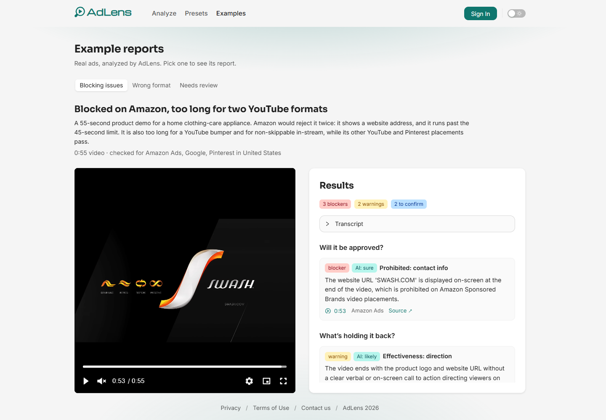

# AdLens

AI policy checks for video ads. Upload an ad of up to 60 seconds, say where it will run (platforms, placements,
markets), and AdLens checks it against the platforms' ad policies and creative best practices. Every finding is
timestamped, cites the policy or guide it comes from, and seeks the replayed video when clicked.

**[Try it live](https://www.useadlens.com)** · **[Example reports](https://www.useadlens.com/demo)** (no sign-up)

[](https://github.com/haggifer/adlens/actions/workflows/ci.yml)
[](LICENSE.md)



AdLens is four repositories. This one is the web app; start here.

| Repo                                                       | What it is                                                                                                |
| ---------------------------------------------------------- | --------------------------------------------------------------------------------------------------------- |
| **adlens** (this repo)                                     | Next.js web app on Vercel                                                                                 |
| [adlens-api](https://github.com/haggifer/adlens-api)       | NestJS API, the Gemini analysis worker and the daily cleanup on Cloud Run (with the architecture diagram) |
| [adlens-shared](https://github.com/haggifer/adlens-shared) | The API contract: Zod schemas and inferred types, published to npm                                        |
| [adlens-lab](https://github.com/haggifer/adlens-lab)       | Evaluation harness that runs the production analysis code on batches of videos, with traces and cost      |

## Highlights

- **Race-safe job lifecycle.** Every status change is one conditional update on the expected status, so a double
  click or a retried request can't verify, charge or start an analysis twice, and a failed run is always refunded
  ([API: Job lifecycle](https://github.com/haggifer/adlens-api#job-lifecycle)).
- **Uploads go straight to Cloud Storage** through V4 signed URLs that bind the exact type and size and can only
  create, so the API never carries the video and a verified upload can't be replaced.
- **One Cloud Run image, three entry points:** the API, an on-demand analysis job (one execution per analysis,
  nothing running between them) and a scheduled daily cleanup
  ([API: Design decisions](https://github.com/haggifer/adlens-api#design-decisions)).
- **Live updates are signals, not data.** The API announces a change over Ably and the tab reads it again through
  the API, which stays the one place that decides what a user may see.
- **A shared Zod contract on npm with exact pins**, rather than a monorepo: the web app and the API deploy
  independently, and every contract change is an explicit version bump
  ([adlens-shared](https://github.com/haggifer/adlens-shared#design-decisions)).
- **Prompt changes are measured before they ship.** The lab runs production's analysis code on the same videos with
  other settings. For example, whole-second timestamps replaced decimals that ran away to the token limit in 6 of 6
  runs ([adlens-lab](https://github.com/haggifer/adlens-lab#lab-defaults-where-the-lab-differs-from-production)).
- **The first analysis needs no account:** an anonymous session starts with the first run, Turnstile only interrupts
  when Cloudflare asks for a click, and the quota is a rolling 7-day window that refunds failed runs.

## Stack

- **Next.js 16** (App Router) + **React 19** + **TypeScript**
- **Ant Design 6** (`antd`, `antd-style`) with `@ant-design/nextjs-registry` for SSR; Bootstrap 5 utility classes
  for layout
- **Better Auth** React client: email and password with email verification and password reset, plus Google and GitHub
  sign-in (`signIn.social` in a popup that reports back from `/auth/done`; when the popup is blocked, in the tab
  itself, where a failed sign-in comes back with `?error=`, shown once by `useSignInErrorNotice`, and only in a
  tab that left for that sign-in), and
  anonymous sessions (Better Auth's anonymous plugin): a visitor is signed in anonymously right before their first
  analysis or first saved preset. The session is an httpOnly, `SameSite=Lax` cookie shared by `www.useadlens.com`
  and `api.useadlens.com`
- **Cloudflare Turnstile** (`@marsidev/react-turnstile`, Managed mode), run when an analysis starts or a contact
  message is sent, and invisible unless Cloudflare asks for a click
- **TanStack Query** for server state, kept current by **Ably** (`ably/modular`, loaded lazily): the API announces
  each change to a user's presets or jobs, and the matching queries are read again
- **Zustand** for UI state (the auth and contact modals, in-app navigation for the Back button)
- **react-hook-form + zod**; the analysis settings form validates with the shared `analysisSettingsSchema`
- Direct-to-GCS uploads via V4 signed URLs, with progress
- **Vidstack** player for the uploaded and replayed video
- **react-swipeable** to open the phone menu with a swipe left anywhere on the page and close it with a swipe right
  (`useMenuSwipe`); it listens only while the menu is shown (below 992px), and leaves swipes that start in a field,
  the player, a dialog or an antd popup to them
- **Jest + React Testing Library** for tests
- Deployed on **Vercel**

## Getting started

```bash
npm install
cp .env.example .env.local
npm run dev
```

Open [http://localhost:3000](http://localhost:3000). It expects the API at `NEXT_PUBLIC_API_BASE_URL` (default
`http://localhost:8080`). Locally, cookies work because `localhost:3000` and `localhost:8080` are the same site.

## Scripts

- `npm run dev` — dev server (Turbopack)
- `npm run build` / `npm run start` — production build and server
- `npm run lint` — ESLint
- `npm run knip` — unused files, exports and dependencies, which ESLint can't see across files (`knip.json`; CI runs it)
- `npm test` — Jest
- `npm run format` — Prettier

## Environment

All three variables are `NEXT_PUBLIC_`, so they're inlined at **build** time; set them per environment in Vercel.

- `NEXT_PUBLIC_API_BASE_URL` — origin of the AdLens API (`https://api.useadlens.com` in production).
- `NEXT_PUBLIC_SITE_URL` — origin of this app (`https://www.useadlens.com` in production). Used for page metadata;
  the links in emails are built by the API from its `WEB_ORIGIN`. Unset, it is `http://localhost:3000`; a production
  build fails without it rather than name localhost as the pages' canonical address.
- `NEXT_PUBLIC_TURNSTILE_SITE_KEY`: the Turnstile widget's site key. Unset, it is Cloudflare's always-pass test key
  `1x00000000000000000000AA`, which works only with the API's test secret; `2x00000000000000000000AB` always fails.
  A production build (`VERCEL_ENV=production`) fails without it rather than ship the test key.

## Routes

| Route            | What it does                                                                                                                                                                                                                                                          |
| ---------------- | --------------------------------------------------------------------------------------------------------------------------------------------------------------------------------------------------------------------------------------------------------------------- |
| `/`              | Upload a video and choose the analysis settings; the password-reset link lands here with `?reset-password-token=`, which opens the reset form in the auth modal and then leaves the address                                                                           |
| `/demo`          | Example reports: a tab per demo analysis (`GET /v1/demos`), each with a summary of what it found, the video and the full report; linked from What you’ll get and, as Examples, from the navigation, which shows it to every visitor (History needs a session)         |
| `/analyses/[id]` | Live status of one analysis, then its results next to the replayed video                                                                                                                                                                                              |
| `/history`       | Every analysis, newest first                                                                                                                                                                                                                                          |
| `/presets`       | The user's presets (saved analysis settings), by name, with how often each was used: create, edit, delete and pick the default; linked from the navigation for everyone: a visitor without a session sees the empty state, since creating a preset starts the session |
| `/account`       | Sign-in methods, change or set a password, sign out other devices, delete the account (anonymous visitors get a sign-up prompt, unconfirmed accounts a Confirm email one)                                                                                             |
| `/confirm-email` | Landing page of the email confirmation link; confirms for the signed-in account and stays to say so (the tab the user came from updates on its own)                                                                                                                   |
| `/auth/done`     | Landing page of the Google / GitHub sign-in popup; reports the outcome to the tab that opened it, then closes                                                                                                                                                         |
| `/terms`         | Terms of Use                                                                                                                                                                                                                                                          |
| `/privacy`       | Privacy Policy                                                                                                                                                                                                                                                        |
| `/sitemap.xml`   | The public pages (`/`, `/demo`, `/terms`, `/privacy`), each also declaring itself canonical, so the http and non-www copies point at www                                                                                                                              |
| `/robots.txt`    | Allows every page and names the sitemap; the private pages stay out of the index through their noindex tag, which a crawler must fetch the page to read                                                                                                               |

## Structure

```
src/
  app/          # routes, root layout and client providers
  api/          # API client, typed endpoints, error codes → user-facing copy
  auth/         # Better Auth client and session context
  components/   # UI by feature
  content/      # long-form MDX content (legal documents)
  contexts/     # Zustand stores
  design/       # antd theme, light/dark scheme and its cookie
  hooks/        # server-state hooks (TanStack Query, live updates), sign-out and other shared UI hooks
  storage/      # signed-URL upload
  test/         # shared test helpers: render with providers, auth states, fixtures
```

Imports use the `@/*` alias, which maps to `src/*`.

## Deployment

Vercel builds and deploys every push to `init-setup` to production at `https://www.useadlens.com` (the apex redirects
to `www`). CI runs lint, types, tests and the build on every push to `init-setup` or `main` and on every pull request.

## Design decisions

About two dozen decisions behind the web app, from live updates to the leave-page guard, are in
[docs/design-decisions.md](docs/design-decisions.md). Decisions shared with the API (cookie sessions on one domain,
the contract package) are in the [API README](https://github.com/haggifer/adlens-api#design-decisions).

## License

[PolyForm Noncommercial 1.0.0](LICENSE.md): free to read, run and learn from, not for commercial use. The analysis
lab ([adlens-lab](https://github.com/haggifer/adlens-lab)) and the contract package
([adlens-shared](https://github.com/haggifer/adlens-shared)) are MIT.
